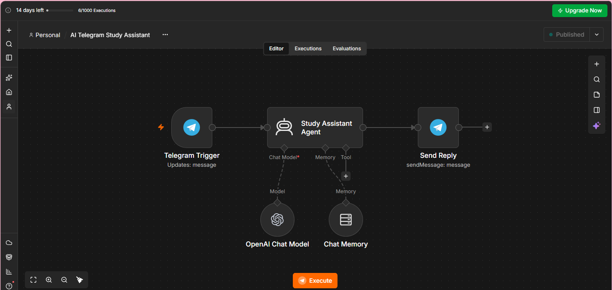
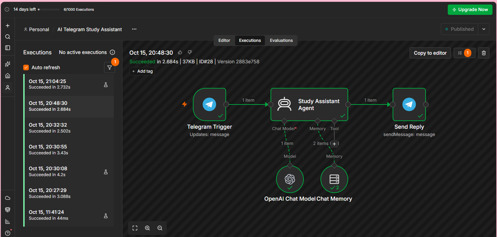
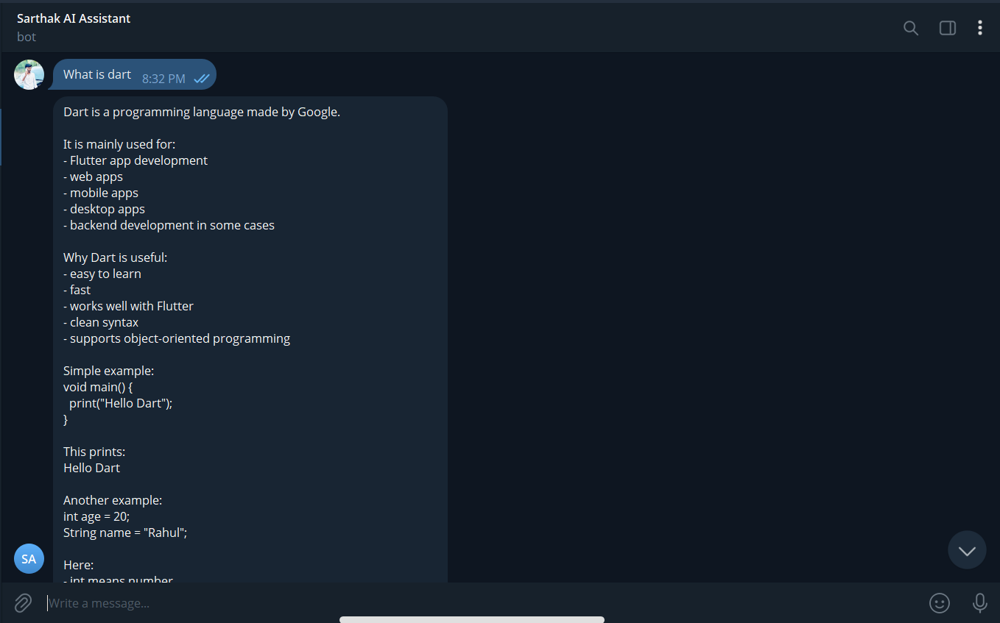

#  AI Telegram Study Assistant

An AI-powered Telegram chatbot built using **n8n, Telegram Bot API, and AI integration** to help students learn programming and solve coding problems.

##  Features

-  **AI-Powered Assistance:** Get explanations for Dart, Flutter, FastAPI, Python, and SQL.
-  **Marathi & English Support:** Receive simple explanations in Marathi or English.
-  **Coding Error Assistance:** Understand coding errors with step-by-step explanations and examples.
-  **Conversational Memory:** Remembers the last 10 messages to maintain conversational context.
-  **Automated Replies:** Receive AI-generated answers directly on Telegram.
-  **English Communication:** Get help improving English communication skills.

##  Tech Stack

- **n8n:** Workflow Automation
- **Telegram Bot API:** Messaging Integration
- **AI Agent:** Request Processing and Response Generation
- **OpenAI Chat Model (GPT-5.4-mini):** AI-Powered Responses
- **Chat Memory:** Conversational Context Management

##  How It Works

1. The user sends a message to the Telegram bot.
2. Telegram Trigger receives the incoming message.
3. The Study Assistant Agent processes the question.
4. The AI model generates a relevant response using the available conversation context.
5. Send Reply delivers the response to the user's Telegram chat.

### Workflow Architecture

```
Telegram Message
       ↓
Telegram Trigger
       ↓
Study Assistant Agent
       ↓
AI Model + Chat Memory
       ↓
Send Reply
       ↓
Telegram Response
```

##  Project Screenshots

### 1. n8n Workflow



### 2. Successful Workflow Execution



### 3. Telegram Bot Demo: Dart



### 4. Telegram Bot Demo: FastAPI 422 Error

.png>)

##  Try the Bot

[Open AI Telegram Study Assistant](https://t.me/sarthak_learning_helper_bot)

##  Setup Instructions

1. Import the workflow JSON file into your n8n workspace.
2. Create your own Telegram bot using Telegram's BotFather.
3. Configure your Telegram credentials in n8n.
4. Configure the required AI model credentials.
5. Verify the node settings and test the workflow.
6. Publish the workflow after successful testing.

**Note:** You may need to configure your own credentials and AI model access before running the workflow.

##  Security

- Never upload Telegram bot tokens or API keys.
- Keep passwords and other credentials private.
- Review exported workflow JSON files before publishing them.
- Configure your own credentials when importing the workflow.

##  What I Learned

Through this project, I gained practical experience with:

- Workflow automation using n8n
- Telegram Bot integration
- AI Agent configuration
- API integration concepts
- Conversational memory
- Testing and debugging automation workflows

##  Author

**Sarthak Ghotekar**

- Live Demo: [Open Telegram Bot](https://t.me/sarthak_learning_helper_bot)
- GitHub: [SarthakGhotekar2007-dev](https://github.com/SarthakGhotekar2007-dev)
- LinkedIn: [Connect with me](https://www.linkedin.com/in/sarthak-ghotekar-137845389)

---

If you find this project useful, consider giving the repository a star!
